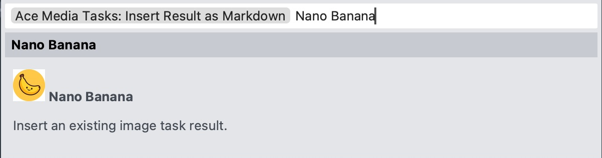

# AceMediaTasks

Insert an existing media task's output into a Markdown document in Sublime Text. The command replaces your selected task ID, or inserts at the caret. Images use Markdown image syntax. Audio and video use links. A task with several results lets you choose which asset to use.



## Use the command

1. Install **AceMediaTasks** with Package Control when available, or choose **Preferences → Browse Packages** and clone this repository as `AceMediaTasks` inside the `Packages` directory for a manual installation.
2. Open **Preferences: Ace Media Tasks Settings** from the Command Palette. Add only the services you use to your personal settings. For example:

   ```json
   {
       "service_tokens": {
           "suno": "YOUR_SUNO_APPLICATION_TOKEN",
           "seedream": "YOUR_SEEDREAM_APPLICATION_TOKEN"
       }
   }
   ```

   You may also set `ACEDATACLOUD_API_TOKEN` in the environment that starts Sublime Text. A service-specific value takes precedence. [Manage service applications](https://platform.acedata.cloud/console/applications?utm_source=opensource&utm_medium=referral&utm_campaign=evergreen).
3. Select a task ID in a document or place the caret where you want the link. Run **Ace Media Tasks: Insert Result as Markdown**, choose the service and confirm the task ID. The service picker shows its artwork. The plugin checks the task ID in the response and inserts only a public HTTPS asset link.

| Service | Settings key | Result |
| --- | --- | --- |
| ACE Music | `acemusic` | Audio link |
| Suno | `suno` | Audio link |
| Nano Banana | `nano-banana` | Image |
| GPT Image | `openai` | Image |
| Seedream | `seedream` | Image |
| FLUX | `flux` | Image |
| Seedance | `seedance` | Video link |
| Kling | `kling` | Video link |
| Veo | `veo` | Video link |
| Hailuo | `hailuo` | Video link |

## Network access

The command sends the task ID to the selected service's `/tasks` endpoint on `https://api.acedata.cloud`, with that service's bearer token. A lookup can return an unfinished task, an error, or results containing only inline image data. Run the command again when a finished asset URL is available. The plugin inserts the URL into your document without downloading the media. Opening or sharing that document can expose the asset URL to its readers.
